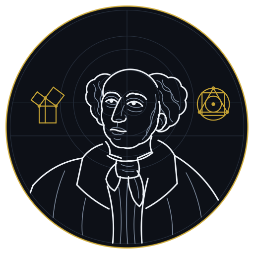

:site_title: Oliver Byrne

.. container:: author-overline

   semantic digital archive • the works of

============
Oliver Byrne
============

**Oliver Byrne** (1810–1880), an Irish civil engineer and mathematician, transformed Euclid's *Elements* in 1847 into one of the most celebrated works of visual pedagogy ever printed. Working with publisher William Pickering and printer Charles Whittingham at the Chiswick Press, he stripped away alphabetic point labels ($A, B, C$) in favor of bold primary red, yellow, blue, and black woodblock diagrams and inline geometric symbols—letting shapes speak directly for themselves on the page.

Books in This Collection
------------------------

.. container:: home-book-hero

   .. container:: home-book-thumb plate-light

      .. image:: coloured_euclid/book-i/47/0082.g1.png
         :alt: Oliver Byrne 1847 Pickering polychrome plate for Proposition I.47 (Pythagorean Theorem)
         :target: coloured_euclid/index.html

   .. container:: home-book-body

      .. rubric:: Chiswick Press Edition · 1847 · Books I–VI · 186 Propositions

      **The First Six Books of the Elements of Euclid** — Byrne's iconic four-color visual treatise, transcribed across Foundations and Books I–VI with **34 cropped 1847 polychrome plates**, **29 calibrated interactive vector diagrams**, inline SVG color tokens, and paired commentary tracks.

      .. container:: home-actions

         * :doc:`Open the Coloured Euclid → <coloured_euclid/index>`
         * :doc:`Enter Book I → <coloured_euclid/book-i/index>`
         * :doc:`Prop. I.47 (Pythagoras) → <coloured_euclid/book-i/47/index>`
         * :doc:`Visual Pseudocode → <pseudocode/index>`

Key Features
------------

.. container:: home-feature-grid

   .. container:: home-feature-card

      **1847 Polychrome Chiswick Press Plates**

      High-resolution full-RGB scans from the Thomas Fisher Rare Book Library pair original red, yellow, blue, and black woodblock prints directly alongside each theorem.

   .. container:: home-feature-card

      **Pointer-Free Visual Pseudocode**

      Inline SVG color tokens (:byrne-line:`red solid`, :byrne-angle:`blue`, :byrne-sq:`black filled`) model Byrne's pass-by-value syntax in :doc:`pseudocode/index` and ``geometor.byrne.pseudocode``.

   .. container:: home-feature-card

      **Exact Symbolic Proofs**

      Flagship propositions across Books I–VI are reconstructed in ``geometor.model`` over exact algebraic fields ($\mathbb{Q}, \mathbb{Q}(\sqrt{3}), \mathbb{Q}(\phi)$) and verified via Rational Trigonometry.

Reference & Project
-------------------

.. container:: home-columns

   .. container:: home-col

      .. rubric:: Scholarly Apparatus

      * :doc:`People <coloured_euclid/people/index>` — Profiles of Oliver Byrne, William Pickering, Charles Whittingham, Robert Simson, Edward Tufte, and Nicholas Rougeux
      * :doc:`Bibliography <coloured_euclid/bibliography>` — Primary 1847 Chiswick Press witness and historical scholarship
      * :doc:`Concordance <coloured_euclid/concordance>` & :doc:`Glossary <coloured_euclid/glossary>` — Byrne–Simson–Heath–G-Index cross-walk and visual terminology

   .. container:: home-col

      .. rubric:: About This Project

      * :doc:`About <about/index>` — Scope, pass-by-value visual grammar, and symbolic geometry design
      * :doc:`Using This Edition <usage/index>` — Navigation guide, folio links, and inline token interaction
      * :doc:`Log <log/index>` & :doc:`Modules <modules/index>` — Development journal and Python API reference

.. toctree::
   :maxdepth: 2
   :hidden:

   coloured_euclid/index
   coloured_euclid/people/index
   coloured_euclid/bibliography
   about/index
   usage/index
   pseudocode/index
   log/index
   modules/index
